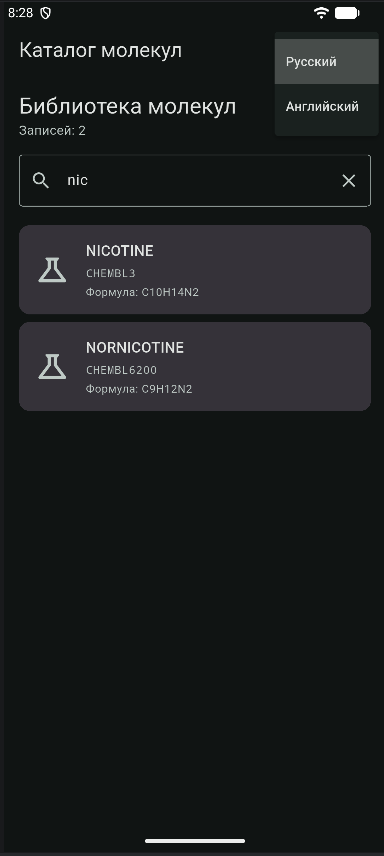
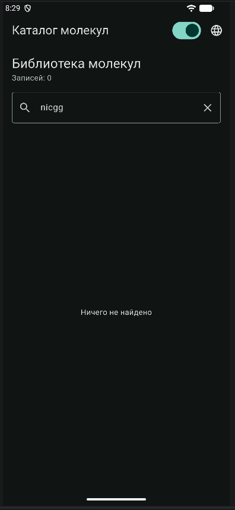
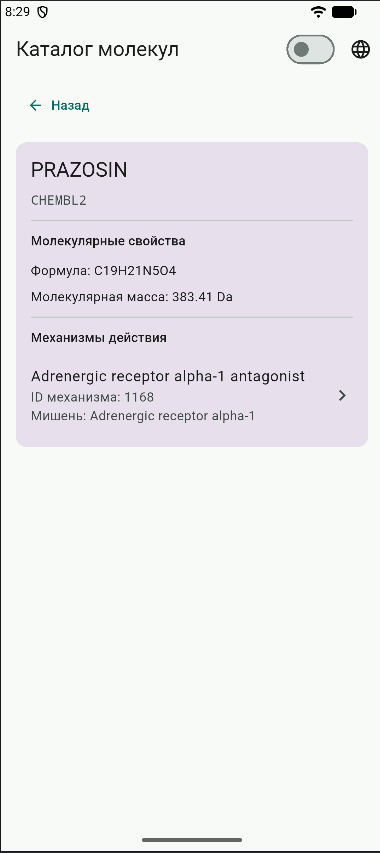
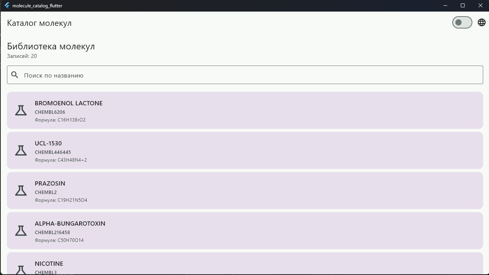
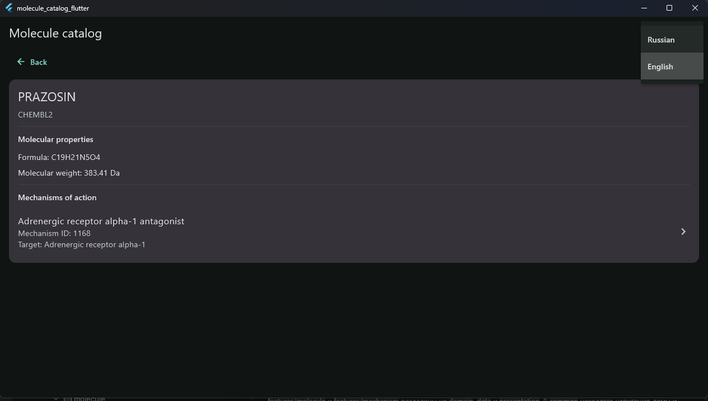

# Каталог молекул — Flutter

Каталог соединений по данным ChEMBL: список, деталь молекулы и связанный
экран механизма действия. Список и детали молекул загружаются из ChEMBL API.
Механизмы действия пока берутся из локальных данных ЛР2; их перевод на API —
следующий шаг ЛР3.

## Возможности

- Поиск по части названия без учёта регистра и сообщение «Ничего не найдено».
- Возврат с сохранением запроса, результатов и позиции списка.
- Светлая и тёмная темы, русский и английский интерфейс.
- Настройки хранятся в памяти сессии. Переводятся только подписи интерфейса.
- Индикаторы загрузки и сообщение об ошибке с кнопкой «Повторить».

## Подготовка и запуск

Нужен Flutter SDK с версией Dart, совместимой с `pubspec.yaml`.
Команды выполняются из корня проекта:

```bash
flutter pub get
flutter gen-l10n
dart run build_runner build
```

Локализация генерируется из `lib/l10n/*.arb`; сгенерированные Dart-файлы
не хранятся в Git. Эти же команды устраняют отсутствие `AppLocalizations`.

| Платформа | Что требуется | Команда |
| --- | --- | --- |
| Web | Chrome или Edge | `flutter run -d chrome` или `flutter run -d edge` |
| Windows | Visual Studio 2022 с «Desktop development with C++» | `flutter run -d windows` |
| Android | Android SDK и эмулятор либо телефон | `flutter run -d <android-device-id>` |


## Архитектура

`features/molecule` содержит сценарии каталога, включая экран механизма
выбранной молекулы, и разделён на `domain`, `data` и `presentation`.
`features/mechanism` содержит модель и репозиторий механизмов с правилом
связи по ID формы вещества и исходного соединения. Зависимость направлена
от `molecule` к `mechanism`; обратных импортов нет.
В `common` находятся навигация, темы и настройки; в `l10n` — переводы.
Состоянием управляет `flutter_bloc` с Cubit,
репозитории предоставляются по интерфейсам. Навигация — `go_router`
с идентификаторами в пути и переходами через `push`/`pop`.
Для молекул цепочка загрузки: `MoleculeApi` → `NetworkMoleculeDataSource` →
`MoleculeRepository` → Cubit → экран. DTO генерируются через
`json_serializable`; сгенерированные `*.g.dart` хранятся в Git.
Общий экземпляр Dio создаётся в корне приложения, базовый адрес и таймауты
настроены в `common/network/dio_client.dart`.

## Данные и ограничения

Загружаются первые 20 молекул, у которых `pref_name` отличается от `null`,
упорядоченные по ChEMBL ID. Поиск пока выполняется только по загруженной странице.
Деталь молекулы получает данные отдельным запросом по ID. Отсутствующие формула
и масса отображаются как «Нет данных»; вместо отсутствующего названия используется ID.
Пагинация пока не реализована.

Для механизмов пока используются 11 локальных записей ChEMBL для 9 молекул
из каталога ЛР2. Связь учитывает ID формы вещества и исходного соединения.
Для остальных молекул отображается отсутствие данных в локальном каталоге.
Изображения структур заменены иконками-заглушками.

Скриншоты ниже относятся к версии ЛР2, проверенной на Android, Web и Windows.

## Скриншоты

### Android

| Светлая тема | Тёмная тема |
| --- | --- |
|  |  |

| Поиск и выбор языка | Ничего не найдено |
| --- | --- |
|  |  |

Деталь молекулы:



### Windows

| Список молекул | Деталь молекулы и выбор языка |
| --- | --- |
|  |  |

Механизм действия:


| Ничего не найдено | Результаты поиска |
| --- | --- |
|  |  |
