# Каталог молекул — Flutter

Каталог соединений по данным ChEMBL: список, деталь молекулы и связанный
экран механизма действия. Молекулы, механизмы действия и названия мишеней
загружаются из ChEMBL API.

## Возможности

- Поиск через ChEMBL API по части основного названия (`pref_name`) без учёта
  регистра или точному ChEMBL ID.
- Сообщение «Ничего не найдено» для пустого результата серверного поиска.
- Подгрузка следующих страниц по 20 записей при прокрутке, без повторов.
- Счётчик загруженных записей и общего количества совпадений.
- Возврат с сохранением запроса, результатов и позиции списка.
- Светлая и тёмная темы, русский и английский интерфейс.
- Настройки хранятся в памяти сессии. Переводятся только подписи интерфейса.
- Индикаторы загрузки и сообщение об ошибке с кнопкой «Повторить».

## Подготовка и запуск

Нужен Flutter SDK с версией Dart, совместимой с `pubspec.yaml`.
Команды выполняются из корня проекта:

```bash
flutter pub get
flutter gen-l10n
dart run build_runner build
```

Локализация генерируется из `lib/l10n/*.arb`; сгенерированные Dart-файлы
не хранятся в Git. Эти же команды устраняют отсутствие `AppLocalizations`.

| Платформа | Что требуется | Команда |
| --- | --- | --- |
| Web | Chrome или Edge | `flutter run -d chrome` или `flutter run -d edge` |
| Windows | Visual Studio 2022 с «Desktop development with C++» | `flutter run -d windows` |
| Android | Android SDK и эмулятор либо телефон | `flutter run -d <android-device-id>` |


## Архитектура

`features/molecule` содержит сценарии каталога, включая экран механизма
выбранной молекулы, и разделён на `domain`, `data` и `presentation`.
`features/mechanism` содержит модель и репозиторий механизмов с правилом
связи по ID формы вещества и исходного соединения. Зависимость направлена
от `molecule` к `mechanism`; обратных импортов нет.
В `common` находятся навигация, темы и настройки; в `l10n` — переводы.
Состоянием управляет `flutter_bloc` с Cubit,
репозитории предоставляются по интерфейсам. Навигация — `go_router`
с идентификаторами в пути и переходами через `push`/`pop`.
Для обеих фич цепочка загрузки: API-клиент → сетевой датасорс → репозиторий →
Cubit → экран. API-клиенты возвращают DTO; датасорсы преобразуют сетевые ошибки
в `LoadException`, а репозитории переводят DTO в доменные модели.
DTO генерируются через
`json_serializable`; сгенерированные `*.g.dart` хранятся в Git.
Общий экземпляр Dio создаётся в корне приложения, базовый адрес и таймауты
настроены в `common/network/dio_client.dart`.

## Данные и ограничения

Молекулы загружаются страницами по 20 записей, упорядоченными по ChEMBL ID.
При прокрутке добавляется следующая страница; уже загруженные записи сохраняются
при ошибке подгрузки, а запрос можно повторить кнопкой в конце списка.
Каталог по умолчанию показывает записи, у которых `pref_name` отличается от `null`.
Поиск выполняется на сервере по всем записям
с названием; точный ChEMBL ID позволяет найти и запись без названия.
Синонимы и русские варианты названий в поиске не учитываются.
При вводе запроса предыдущий ответ не может заменить результат нового поиска.
Деталь молекулы получает данные отдельным запросом по ID. Отсутствующие формула
и масса отображаются как «Нет данных»; вместо отсутствующего названия используется ID.

Молекула и её механизмы загружаются параллельно. Механизмы запрашиваются с
ID выбранной записи в фильтрах `molecule_chembl_id` и
`parent_molecule_chembl_id`; результаты объединяются
без повторов по ID механизма. Названия мишеней получаются пакетными запросами
к `target`. Экран механизма отдельно запрашивает запись по ID и проверяет
её связь с молекулой. Пустой успешный ответ отображается как отсутствие данных,
а ошибка загрузки — как сообщение с кнопкой «Повторить».
Для солевых форм переход к родителю из `molecule_hierarchy` не выполняется,
поэтому механизмы родительского соединения могут не попасть в результат.
При ошибке загрузки связанных данных деталь целиком показывает ошибку;
кнопка «Повторить» заново загружает молекулу и связанные записи.

Моков в `lib/` нет. Снимок ответов из ЛР2 сохранён только для справки в
`docs/reference/chembl_snapshot.json`; приложение его не читает.
Изображения структур заменены иконками-заглушками.

## ЛР3: данные из сети

Скриншоты Web-версии с запросами к ChEMBL API:

| Список | Деталь |
| --- | --- |
| 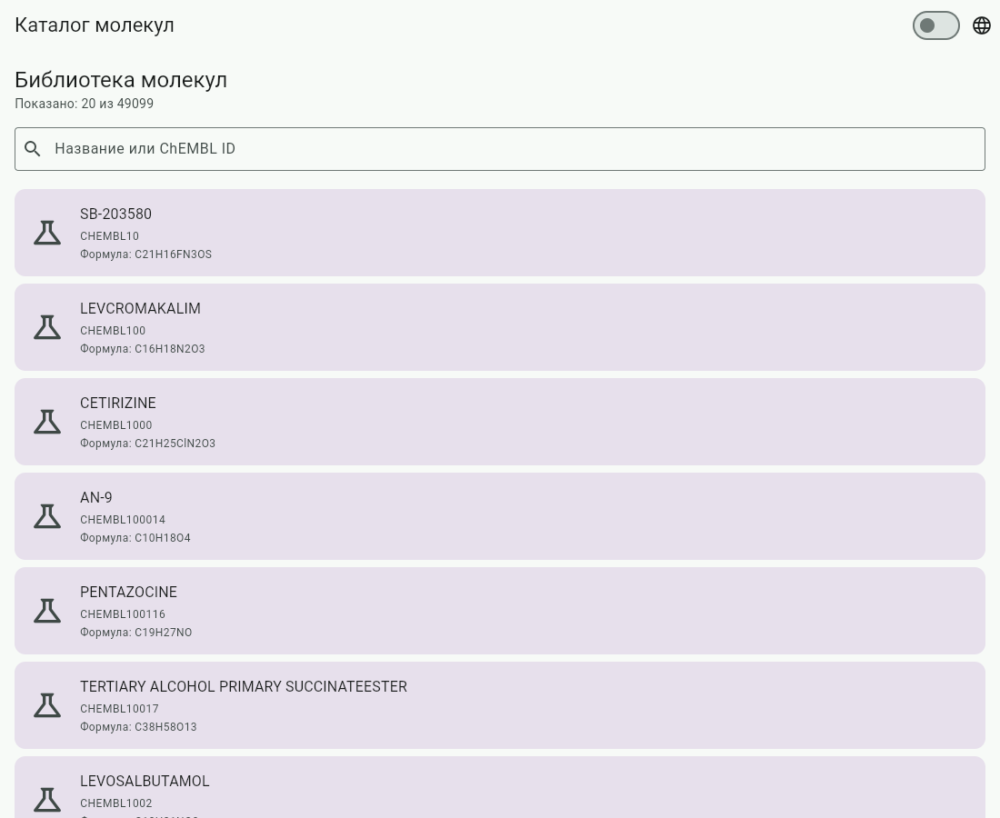 | 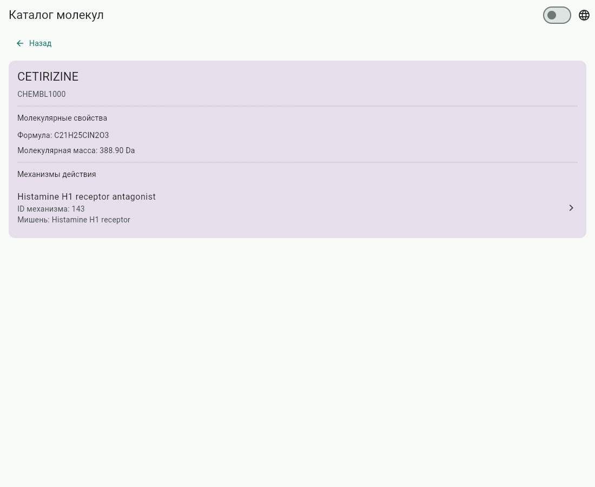 |

| Список в узком окне | Деталь в узком окне |
| --- | --- |
| 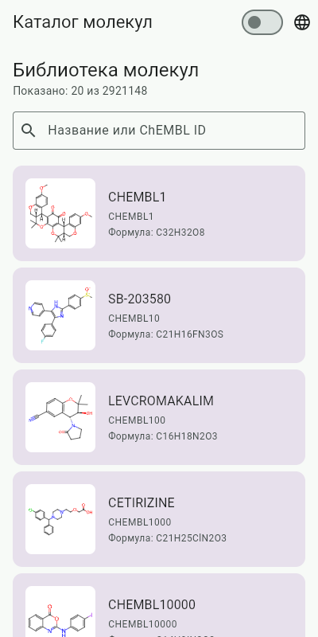 | 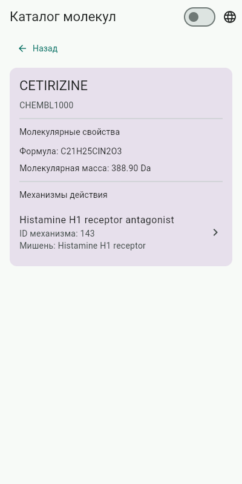 |

| Ошибка подключения и повтор | Запросы в DevTools Network |
| --- | --- |
| 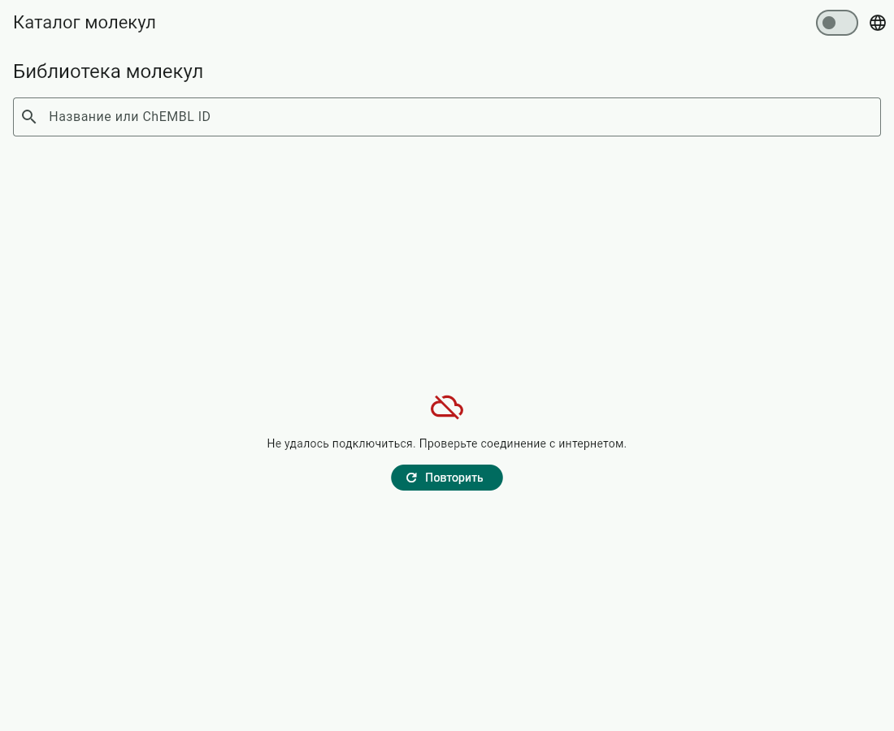 | 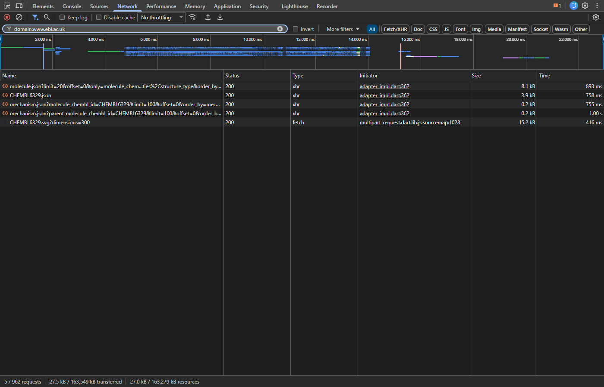 |

Описание для PR: [ЛР3 — Сеть](docs/lab-3-pr.md).

Скриншоты ЛР2 ниже относятся к версии с моками, проверенной на Android,
Web и Windows.

## Скриншоты ЛР2

### Android

| Светлая тема | Тёмная тема |
| --- | --- |
| 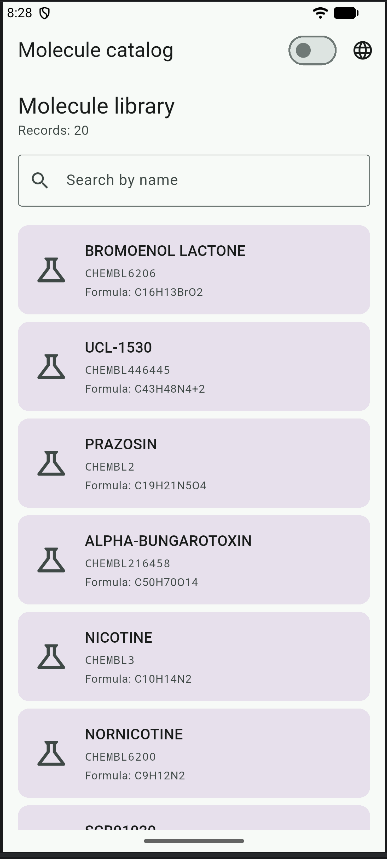 | 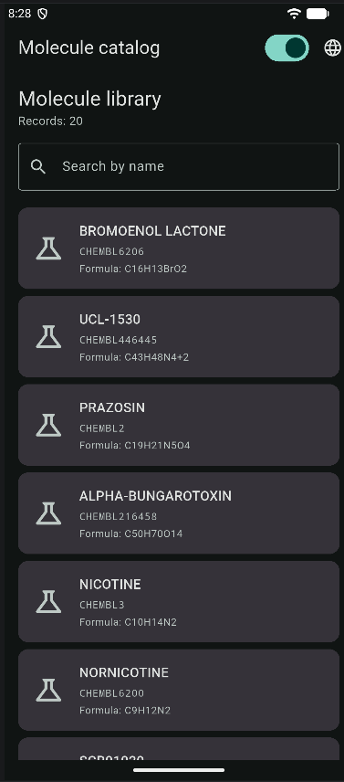 |

| Поиск и выбор языка | Ничего не найдено |
| --- | --- |
|  |  |

Деталь молекулы:


### Windows

| Список молекул | Деталь молекулы и выбор языка |
| --- | --- |
|  |  |

Механизм действия:

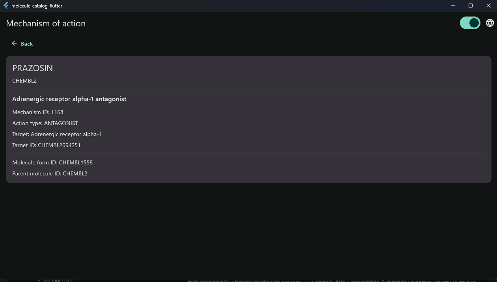

| Ничего не найдено | Результаты поиска |
| --- | --- |
| 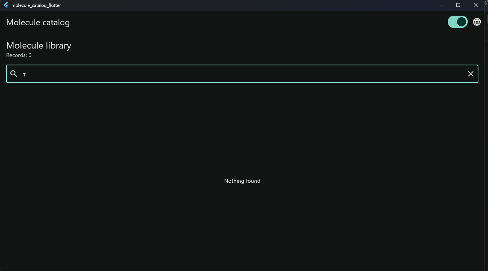 | 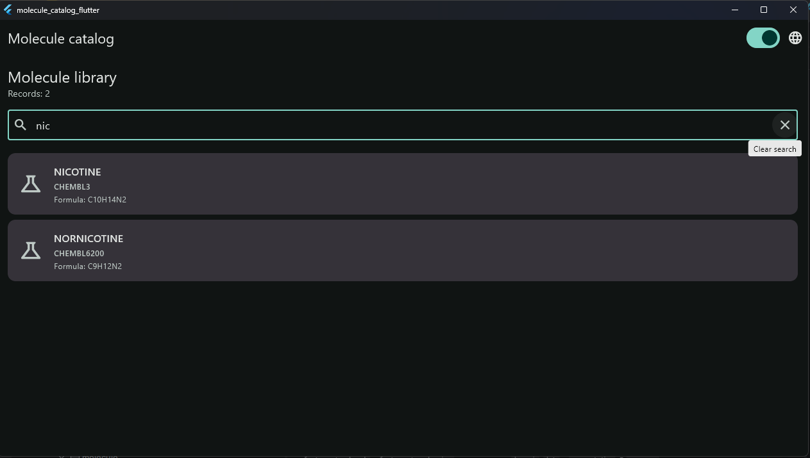 |
