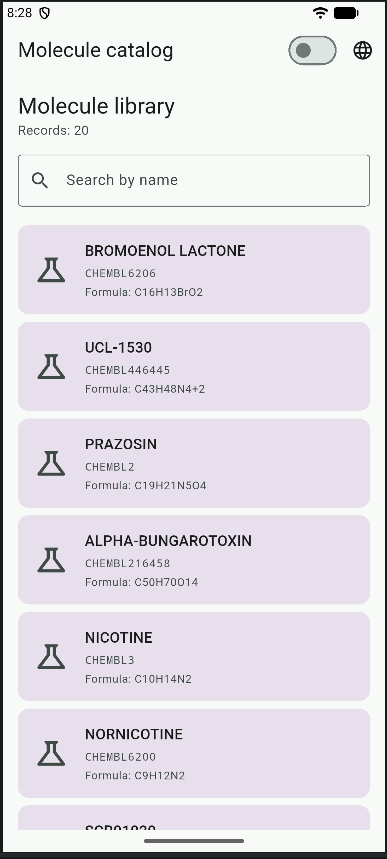
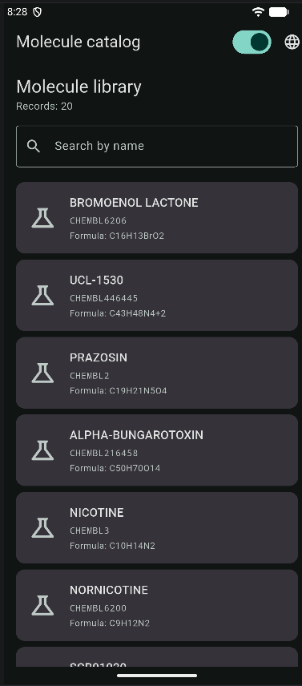
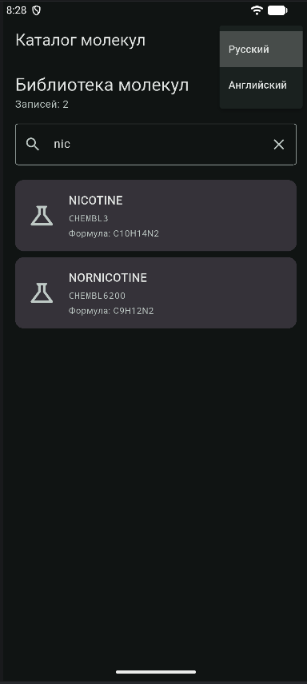
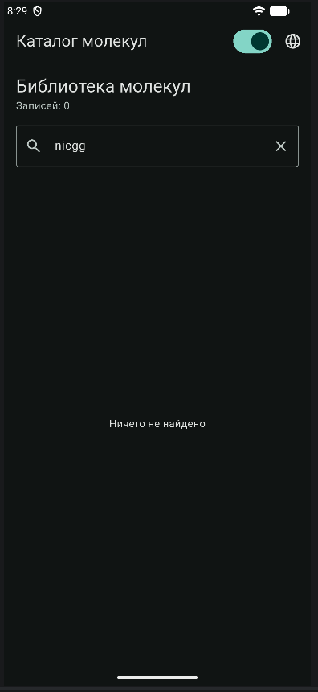
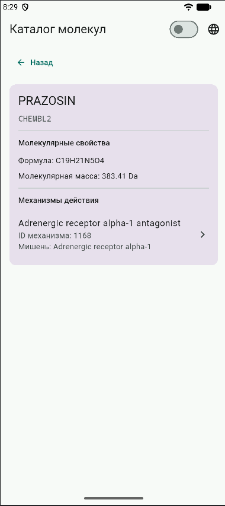
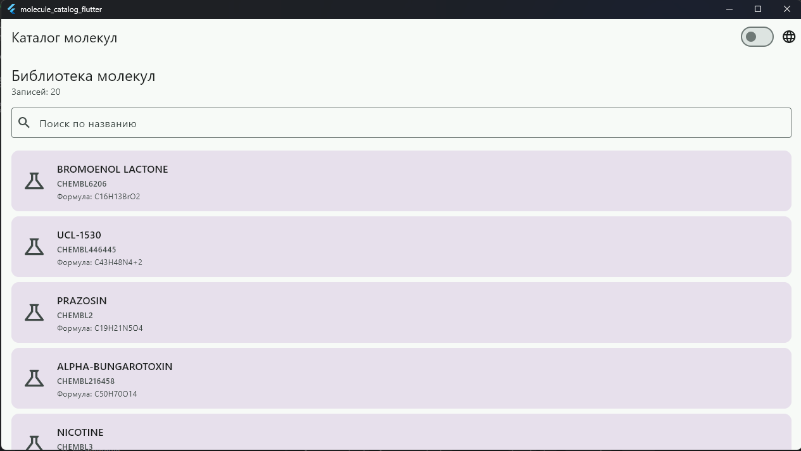
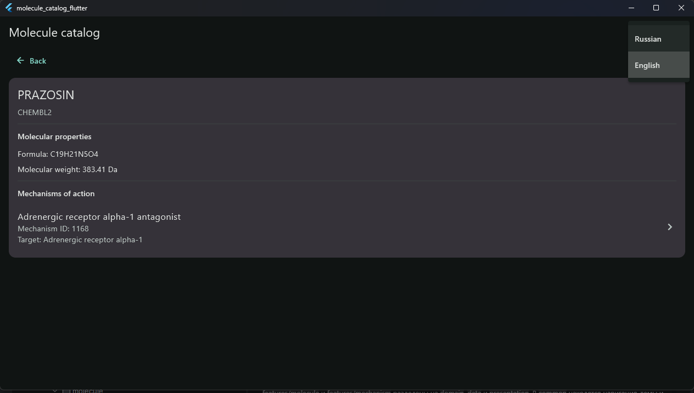
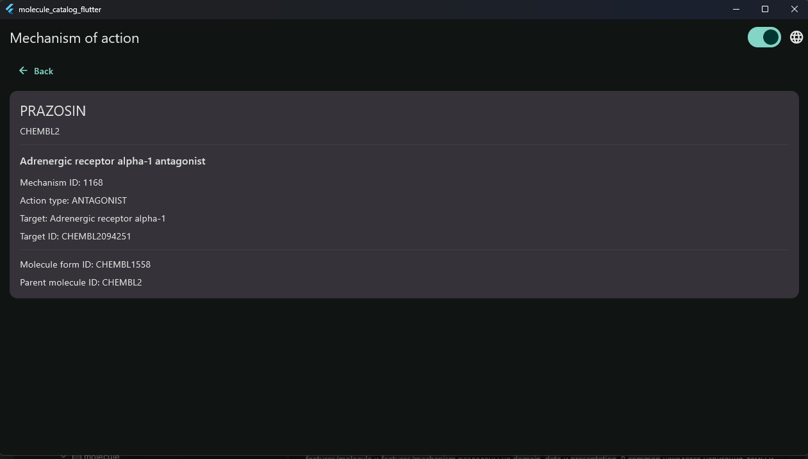
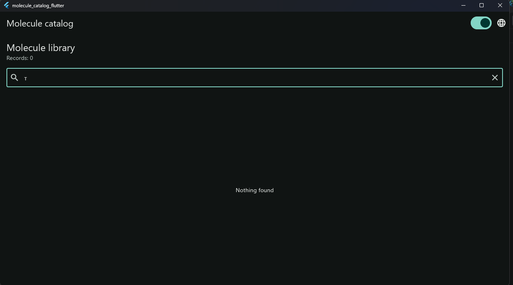
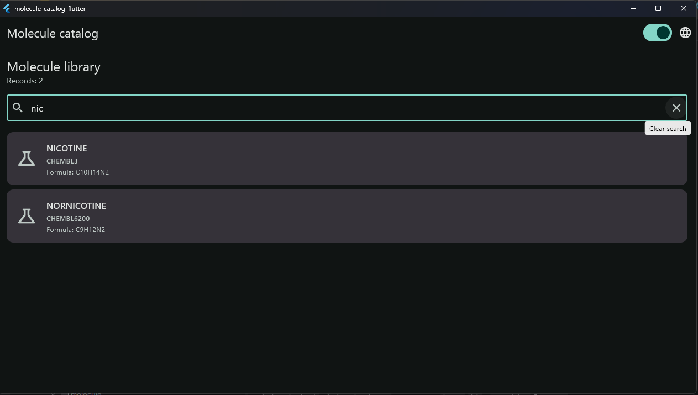

# Каталог молекул — ЛР2 на Flutter

Каталог соединений по данным ChEMBL: список, деталь молекулы и связанный
экран механизма действия. Приложение работает на локальных моках, без сети.

## Возможности

- Поиск по части названия без учёта регистра и сообщение «Ничего не найдено».
- Возврат с сохранением запроса, результатов и позиции списка.
- Светлая и тёмная темы, русский и английский интерфейс.
- Настройки хранятся в памяти сессии. Переводятся только подписи интерфейса.

## Подготовка и запуск

Нужен Flutter SDK с версией Dart, совместимой с `pubspec.yaml`.
Команды выполняются из корня проекта:

```bash
flutter pub get
flutter gen-l10n
```

Локализация генерируется из `lib/l10n/*.arb`; сгенерированные Dart-файлы
не хранятся в Git. Эти же команды устраняют отсутствие `AppLocalizations`.

| Платформа | Что требуется | Команда |
| --- | --- | --- |
| Web | Chrome или Edge | `flutter run -d chrome` или `flutter run -d edge` |
| Windows | Visual Studio 2022 с «Desktop development with C++» | `flutter run -d windows` |
| Android | Android SDK и эмулятор либо телефон | `flutter run -d <android-device-id>` |


## Архитектура

`features/molecule` и `features/mechanism` разделены на `domain`, `data`
и `presentation`. В `common` находятся навигация, темы и настройки;
в `l10n` — переводы. Состоянием управляет `flutter_bloc` с Cubit,
репозитории предоставляются по интерфейсам. Навигация — `go_router`
с идентификаторами в пути и переходами через `push`/`pop`.

## Данные и ограничения

Используются 20 молекул из ЛР1 и 11 записей механизмов ChEMBL для 9 молекул.
Связь учитывает ID формы вещества и исходного соединения. Для остальных
молекул отображается отсутствие данных в локальном каталоге.
Изображения структур заменены иконками-заглушками.

Запуск и сценарии поиска, навигации, темы и языка проверены вручную
на Android, Web и Windows.

## Скриншоты

### Android

| Светлая тема | Тёмная тема |
| --- | --- |
|  |  |

| Поиск и выбор языка | Ничего не найдено |
| --- | --- |
|  |  |

Деталь молекулы:



### Windows

| Список молекул | Деталь молекулы и выбор языка |
| --- | --- |
|  |  |

Механизм действия:



| Ничего не найдено | Результаты поиска |
| --- | --- |
|  |  |
